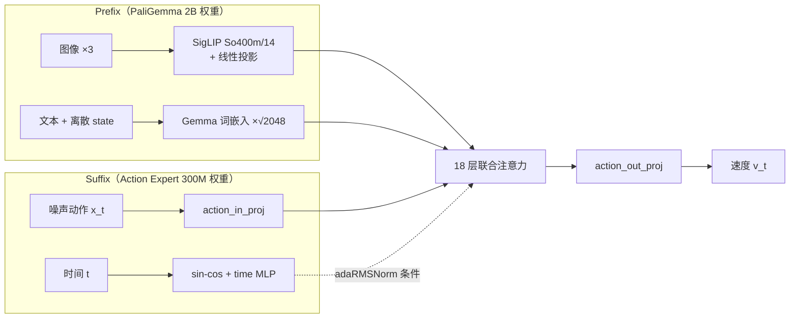

# π₀ / π₀.₅ 模型代码教学导读

本文面向想读懂 **模型本身** 的读者：从 `Observation` 进入模型开始，到输出 `[B, H, D]` 动作块为止。
数据集、split、归一化、训练主循环、服务端和 SIMPLE 客户端已在
[训练代码导读](g1_dex3_training_code_walkthrough.md) 中讲过，这里只在需要时引用。

代码基线：`main@47b4104`。下文所有路径都相对 `src/openpi4OpenHLM/src/openpi/`。

---

## 0. 先建立直觉：这个模型在做什么

π₀ / π₀.₅ 是一个 **VLA（Vision-Language-Action）模型**，结构上可以拆成三件事：

1. **看和读**：SigLIP 把图像编码成 token，Gemma 2B 的词表把文字（π₀.₅ 还包括离散化后的状态）编码成 token。
   这一段叫 **prefix（前缀）**，只依赖观测，和动作无关。
2. **想动作**：一个更小的 Gemma 300M，称作 **action expert（动作专家）**，接收"加了噪声的动作块"和
   "当前噪声强度 t"，输出一个速度场 `v`，告诉噪声该往哪个方向走才能变成真实动作。
   这一段叫 **suffix（后缀）**。
3. **两者如何交流**：两套 Transformer 的权重 **完全独立**，但 **每一层的 self-attention 是拼在一起算的**。
   suffix 的 query 可以看到 prefix 的 key/value，反之不行。这种结构常被称为
   Mixture-of-Transformers（多套权重、共享注意力）。

训练时用 **flow matching**：随机挑一个噪声强度 `t`，把真实动作和高斯噪声线性插值，让网络预测
"噪声减动作"这个速度。推理时从纯噪声出发，用欧拉法积分 10 步，得到动作块。



---

## 1. 代码地图

| 文件 | 角色 | G1 训练是否走这里 |
|---|---|---|
| `models/model.py` | `Observation`、`BaseModelConfig`、`BaseModel` 抽象，JAX 版预处理，checkpoint 恢复 | 部分（`Observation`、`load_pytorch`） |
| `models/pi0_config.py` | `Pi0Config`：所有模型超参和开关 | 是 |
| `models_pytorch/pi0_pytorch.py` | **PyTorch 主模型** `PI0Pytorch`：embedding、loss、采样 | **是，核心** |
| `models_pytorch/gemma_pytorch.py` | `PaliGemmaWithExpertModel`：两套 Gemma 的逐层联合注意力 | **是，核心** |
| `models_pytorch/preprocessing_pytorch.py` | PyTorch 版图像 resize 和数据增强 | 是 |
| `models_pytorch/transformers_replace/` | 打过补丁的 HF `transformers`（adaRMSNorm、gated residual、KV cache 行为） | 是 |
| `models/tokenizer.py` | `PaligemmaTokenizer`：π₀.₅ 的"文本 + 离散 state"提示词 | 是 |
| `models/pi0.py` | JAX/Flax NNX 参考实现，逻辑与 PyTorch 版一一对应 | 否（对照阅读用） |
| `models/gemma.py`、`siglip.py`、`lora.py` | JAX 版 Gemma / SigLIP / LoRA | 否（`gemma.get_config` 被 PyTorch 复用） |
| `models/pi0_fast.py` | π₀-FAST：把动作离散成 token 自回归生成 | 否 |
| `shared/nnx_utils.py` | JAX NNX 工具：`module_jit`、`PathRegex`、`state_map` | 否（JAX 推理和冻结用） |

阅读建议：**以 PyTorch 代码为主线，JAX 版 `pi0.py` 作为"更短的伪代码"对照**。两者的函数名
（`embed_prefix`、`embed_suffix`、`compute_loss`/`forward`、`sample_actions`）和步骤几乎一致，
JAX 版只有 280 行，结构更容易一眼看清。

---

## 2. 配置：`Pi0Config`

`models/pi0_config.py` 是一个 frozen dataclass，模型构造只读它。

```python
paligemma_variant = "gemma_2b"       # prefix 主干
action_expert_variant = "gemma_300m" # 动作专家
action_dim = 32                      # 默认值；G1 配置改为 36
action_horizon = 50                  # 默认值；G1 配置改为 30
pi05 = False                         # G1 配置为 True
max_token_len = None                 # __post_init__: pi05 → 200, pi0 → 48
discrete_state_input = None          # __post_init__: 默认等于 pi05
timestep_distribution = "shifted_beta"
x_pred = False
use_drifting = False
use_training_time_rtc = False
```

`__post_init__` 里用 `object.__setattr__` 给 frozen dataclass 填默认值，这是 frozen dataclass
惯用的写法。

### 2.1 两个 Gemma 的尺寸

由 `models/gemma.py` 的 `get_config()` 给出：

| variant | width | depth | mlp_dim | num_heads | num_kv_heads | head_dim |
|---|---|---|---|---|---|---|
| `gemma_2b` | 2048 | 18 | 16384 | 8 | 1 | 256 |
| `gemma_300m` | 1024 | 18 | 4096 | 8 | 1 | 256 |

关键观察：**宽度不同，但层数、头数、head_dim 完全相同**。这是联合注意力能成立的前提——
两边算出的 Q/K/V 都是 `[B, 8 或 1, seq, 256]`，可以直接在序列维拼接。JAX 版 `gemma.py` 的
`Attention` 里有三行 `assert` 明确检查这一点。

`num_kv_heads=1` 表示 **Multi-Query Attention**：8 个 query 头共享 1 组 K/V，推理时 KV cache 只有
普通多头注意力的 1/8。

### 2.2 π₀ 与 π₀.₅ 的两处差异

`Pi0Config` 的注释写得很清楚：

| | π₀ | π₀.₅（G1 使用） |
|---|---|---|
| 状态怎么进模型 | suffix 里一个连续 token：`state_proj(state)` | prefix 文本里：`State: 128 37 201 ...` |
| 时间步怎么进模型 | 和动作 token 拼接后过 MLP | 过 time MLP 后作为 **adaRMSNorm 条件**，调制 expert 每一层 |

后面所有 `if self.pi05:` 分支都围绕这两点展开。

### 2.3 G1 配置实际取值

`training/config.py` 中 `pi05_simple_g1_dex3_tabletop`：

```python
Pi0Config(pi05=True, action_dim=36, action_horizon=30, ...)
```

其余模型字段（`x_pred`、`use_drifting`、`use_training_time_rtc`、`timestep_distribution`）都保持默认，
所以 **G1 训练走的是标准 π₀.₅ flow matching 路径**。第 9 节介绍的实验开关可以先跳过。

---

## 3. 模型输入：`Observation`

`models/model.py` 定义了模型唯一认的输入结构：

```python
@struct.dataclass
class Observation(Generic[ArrayT]):
    images: dict[str, Float["*b h w c"]]       # 值域 [-1, 1]
    image_masks: dict[str, Bool["*b"]]          # 该相机是否有效
    state: Float["*b s"]
    tokenized_prompt: Int["*b l"] | None
    tokenized_prompt_mask: Bool["*b l"] | None
    token_ar_mask / token_loss_mask             # 只有 π₀-FAST 用
```

几个要点：

- `ArrayT` 可以是 JAX array、numpy 或 torch tensor，同一个类在两套框架间共用。
- `@at.typecheck` 借助 jaxtyping 在运行时检查形状记号（`"*b h w c"`）。
- `from_dict()` 是数据 transform 输出（嵌套 dict）到 `Observation` 的唯一入口。若图像是 `uint8`，
  它会转成 `[-1, 1]` 的 float32；**torch 的 uint8 图像还会顺便 permute 成 CHW**，所以 PyTorch 模型
  拿到的是 `[B, 3, 224, 224]`。
- 模型固定期望三路相机 `base_0_rgb / left_wrist_0_rgb / right_wrist_0_rgb`（`IMAGE_KEYS`）。
  G1 只有第一视角，另两路由 `SimpleG1Dex3Inputs` 填零图并把 mask 置 `False`。

G1 一个 batch 进入模型时的形状：

```text
images:               3 × [B, 3, 224, 224]   float, [-1,1]
image_masks:          3 × [B]                [True, False, False]
state:                [B, 36]                前 32 维真实，后 4 维补零
tokenized_prompt:     [B, 200]               int
tokenized_prompt_mask:[B, 200]               bool
actions (训练时):     [B, 30, 36]
```

---

## 4. 预处理：`preprocess_observation_pytorch`

`models_pytorch/preprocessing_pytorch.py` 在 `PI0Pytorch._preprocess_observation()` 中被调用：

1. 判断 channels-first 还是 channels-last，统一转为 HWC 处理。
2. 若分辨率不是 224×224，调用 `resize_with_pad_torch` 等比缩放并补边。
3. `train=True` 时做增强：
   - 非腕部相机：95% 随机裁剪 → 缩放回原尺寸 → ±5° 旋转；
   - 所有相机：亮度、对比度、饱和度抖动。
4. 没提供 mask 的相机默认有效。
5. 返回一个简单对象 `SimpleProcessedObservation`，避免 `Observation` 上的类型注解干扰
   `torch.compile`。

和 JAX 版 `model.preprocess_observation` 对比，有两处 **行为差异** 值得知道：

| | JAX（augmax） | PyTorch |
|---|---|---|
| 随机参数 | `jax.vmap` 后每个样本独立 | `torch.rand(1)`，**整个 batch 共用一组** 裁剪位置 / 角度 / 颜色系数 |
| 饱和度 | HSV 空间 | 向灰度插值的近似 |

所以 PyTorch 版增强的样本多样性弱一些，但 batch 内仍然一致可复现。

---

## 5. 核心一：Prefix / Suffix embedding

`PI0Pytorch` 在 `models_pytorch/pi0_pytorch.py`。先看构造函数里有哪些可学习模块：

```python
self.paligemma_with_expert = PaliGemmaWithExpertModel(...)   # SigLIP + Gemma2B + Gemma300M

action_proj_dim = config.action_dim if config.action_dim > 32 else 32
self.action_in_proj  = nn.Linear(action_proj_dim, 1024)
self.action_out_proj = nn.Linear(1024, action_proj_dim)

if pi05:
    self.time_mlp_in  = nn.Linear(1024, 1024)
    self.time_mlp_out = nn.Linear(1024, 1024)
else:
    self.state_proj          = nn.Linear(32, 1024)
    self.action_time_mlp_in  = nn.Linear(2048, 1024)
    self.action_time_mlp_out = nn.Linear(1024, 1024)
```

`action_proj_dim` 至少为 32，是因为预训练 base 按 32 维训练。G1 是 36 维，所以这两层会比 checkpoint
多 4 行/列，由训练脚本的 weight surgery 补齐（见训练导读第 11 节）。

### 5.1 `embed_prefix`：图像 + 语言

```text
for 每路相机:
    img_emb = embed_image(img)              # [B, 256, 2048]
    pad_mask = image_mask 广播到 256 个 token
    att_mask += [0] * 256

lang_emb = embed_language_tokens(tokens) * sqrt(2048)   # [B, 200, 2048]
att_mask += [0] * 200
```

- `embed_image` = SigLIP 视觉塔 + `multi_modal_projector`。224/14 = 16，每张图 16×16 = **256 个 token**，
  SigLIP 输出宽度 1152，由投影层映射到 Gemma 的 2048。
- 文本 embedding 乘 `sqrt(width)` 是 Gemma 的约定（JAX 版放在 `gemma.Embedder.encode` 内部，
  PyTorch 版显式写在这里）。
- `att_mask` 全为 0，意思是 **prefix 内部全部双向可见**（图像和文字互相看）。

G1 的 prefix 长度：`3 × 256 + 200 = 968` 个 token。其中两路腕部相机的 512 个 token 和文字里的
padding 由 `pad_mask=False` 屏蔽。屏蔽并不节省计算，SigLIP 仍然对零图做了完整前向。

### 5.2 `embed_suffix`：噪声动作 + 时间

π₀.₅ 分支（G1 实际走这条）：

```text
action_emb = action_in_proj(x_t)                    # [B, 30, 36] → [B, 30, 1024]

time_emb = sin-cos(t, dim=1024, min_period=4e-3, max_period=4.0)   # [B, 1024]
time_emb = silu(time_mlp_out(silu(time_mlp_in(time_emb))))         # [B, 1024]
adarms_cond = time_emb

suffix tokens = action_emb
att_mask = [1, 0, 0, ..., 0]                         # 30 个
```

π₀ 分支多一个 state token，并把时间 embedding 复制 30 份拼到动作 token 上再过 MLP，不使用 adaRMS：

```text
tokens   = [state_proj(state)] + MLP(concat(action_emb, time_emb))
att_mask = [1] + [1, 0, 0, ..., 0]
```

`create_sinusoidal_pos_embedding` 是标准 Transformer 位置编码，只是把"位置"换成了标量时间 `t∈[0,1]`。
`min_period=4e-3` 让编码对 `t` 的细微变化敏感。

### 5.3 注意力掩码：`make_att_2d_masks`

这是整个模型里最值得花时间理解的十行代码：

```python
cumsum = torch.cumsum(att_masks, dim=1)
att_2d = cumsum[:, None, :] <= cumsum[:, :, None]     # key 的 cumsum ≤ query 的 cumsum
pad_2d = pad_masks[:, None, :] * pad_masks[:, :, None]
return att_2d & pad_2d
```

规则：**`att_mask` 中的每个 1 开启一个新"块"；一个 token 能看到所有块号不大于自己的 token。**

π₀.₅ 拼接后的 `att_mask` 与块号：

```text
token:     img... img  txt... txt | a0  a1 ... a29
att_mask:   0  ...  0   0  ...  0 |  1   0 ...   0
cumsum:     0  ...  0   0  ...  0 |  1   1 ...   1
```

得到的可见性矩阵（行 = query，列 = key）：

```text
              prefix   suffix
prefix  →  [   ✓        ✗   ]     prefix 看不到动作
suffix  →  [   ✓        ✓   ]     动作看得到观测，动作之间双向可见
```

π₀ 的情况多一个块：

```text
token:    prefix | state | a0 a1 ... a29
cumsum:      0   |   1   |  2  2 ...  2
```

state 能看 prefix 和自己，看不到动作；动作看得到一切。

为什么"prefix 看不到 suffix"这么重要？因为这样 **prefix 的表示与噪声动作和 t 完全无关**，
推理时 prefix 只需算一次，KV 缓存下来，后面 10 步去噪反复复用。

最后 `_prepare_attention_masks_4d` 把布尔掩码转成加性掩码：可见为 `0.0`，不可见为 `-2.38e38`，
形状变为 `[B, 1, Q, K]`。

### 5.4 位置编码

```python
position_ids = torch.cumsum(pad_masks, dim=1) - 1
```

只有有效 token 才推进位置号。G1 中两路腕部相机被 mask，所以文字 token 的位置从 256 开始，
而不是 768。RoPE（旋转位置编码）基于这个 `position_ids` 计算。

---

## 6. 核心二：两套 Gemma 的联合注意力

`models_pytorch/gemma_pytorch.py` 的 `PaliGemmaWithExpertModel` 包含：

```python
self.paligemma    = PaliGemmaForConditionalGeneration(...)  # SigLIP + Gemma 2B
self.gemma_expert = GemmaForCausalLM(...)                  # Gemma 300M
self.gemma_expert.model.embed_tokens = None                # 专家不处理离散 token，删掉词表
```

HF 配置是按 `gemma.get_config()` 的数值手工拼出来的，词表大小 257152 是 PaliGemma 的词表。

### 6.1 `forward` 的三种模式

`forward(inputs_embeds=[prefix, suffix], ...)` 按哪一边为 `None` 分三种情况：

| `inputs_embeds` | 用途 | 做什么 |
|---|---|---|
| `[prefix, None]` | 推理第 1 步 | 只跑 Gemma 2B，`use_cache=True` 返回 KV cache |
| `[None, suffix]` | 推理每个去噪步 | 只跑 Gemma 300M，带着 prefix 的 KV cache |
| `[prefix, suffix]` | 训练 | 逐层手写联合注意力（下面详述） |

### 6.2 联合注意力的一层：`compute_layer_complete`

```text
对 i ∈ {prefix(2B), suffix(300M)}:
    h_i, gate_i = layers_i.input_layernorm(x_i, cond=adarms_cond[i])
    q_i, k_i, v_i = layers_i.q/k/v_proj(h_i)          # 各自的权重

Q = cat(q_prefix, q_suffix)   沿序列维        # [B, 8, 968+30, 256]
K = cat(k_prefix, k_suffix)                   # [B, 1, 998, 256]
V = cat(v_prefix, v_suffix)
Q, K = RoPE(Q, K, position_ids)
O = softmax(Q Kᵀ · 256^-0.5 + mask) V          # 一次注意力，掩码决定谁看谁

对 i:
    o_i = layers_i.o_proj(O[对应区段])          # 8×256=2048 → 各自宽度 2048 / 1024
    x_i = x_i + gate_i · o_i                    # 第一次（门控）残差
    h_i, gate_i = layers_i.post_attention_layernorm(x_i, cond=adarms_cond[i])
    x_i = x_i + gate_i · layers_i.mlp(h_i)      # 第二次（门控）残差
```

用一句话概括：**LayerNorm、QKV 投影、输出投影、MLP 全部各用各的权重；只有 softmax 注意力这一步是
在拼接后的序列上算的。** 这样 2B 模型保留了 VLM 预训练的知识，300M 专家专注于动作，又能逐层读取视觉
语言特征。

18 层跑完后，两边各自过 final norm（`model.norm`），返回 `[prefix_out, suffix_out]`。
模型只取 `suffix_out[:, -30:]` 送入 `action_out_proj`；训练时 prefix 输出直接丢弃，它不贡献任何 loss，
梯度只能沿注意力从 suffix 回传到 prefix。

> 实现细节：`att_output.reshape(batch_size, -1, 1 * 8 * head_dim)` 把头数 8 写死了。
> 换用头数不同的 Gemma variant 时这里必须同步修改。

### 6.3 adaRMSNorm 与门控残差

π₀.₅ 时，expert 的 RMSNorm 构造时带 `cond_dim=1024`，补丁版 `GemmaRMSNorm`
（`transformers_replace/models/gemma/modeling_gemma.py`）变成：

```python
normed = x / sqrt(mean(x²) + eps)                     # float32 计算
scale, shift, gate = chunk(dense(cond), 3)            # dense: 1024 → 3×1024
y = normed * (1 + scale) + shift
return y, gate
```

配合 `_gated_residual(x, y, gate) = x + y * gate`，时间步 `t` 通过 `scale / shift / gate` 调制专家
**每一层、每一次残差**。这与 DiT 的 adaLN-Zero 是同一思想：同一网络在不同噪声强度下表现为不同的函数。

普通 RMSNorm（prefix 侧，或 π₀ 的 expert）则是 `normed * (1 + weight)`，返回的 gate 为 `None`，
残差退化为普通的 `x + y`。

`mixed precision` 的配合：RMSNorm 内部始终用 float32 计算方差和缩放，最后再转回输入 dtype。

### 6.4 精度设置：`to_bfloat16_for_selected_params`

`precision="bfloat16"` 时整体转为 bf16，但以下参数保留 float32：

```text
SigLIP patch_embedding.weight / bias
SigLIP position_embedding.weight
所有 input_layernorm / post_attention_layernorm（含 adaRMS 的 dense）
model.norm（final norm）
```

归一化层和输入嵌入对数值误差最敏感，保留 fp32 是常见做法。也因此 `PI0Pytorch.forward` 中有
"若 q_proj 是 bf16，就把 prefix / suffix embedding 转为 bf16"的显式转换。

### 6.5 为什么需要 `transformers_replace`

这个项目依赖 `transformers==4.53.2`，并要求把 `transformers_replace/` 覆盖进 site-packages。原因是官方
Gemma 没有：

- `GemmaRMSNorm` 的 `cond` 参数和返回 gate；
- `_gated_residual`；
- `GemmaAttention` 在 `use_cache=False` 且传入 `past_key_value` 时 **拼接但不写回** cache 的行为（见 7.2）。

`PI0Pytorch.__init__` 末尾通过 `transformers.models.siglip.check` 检查补丁是否安装，没装就直接报错，
避免静默地跑一个缺了 adaRMS 的模型。

---

## 7. 核心三：训练与推理

### 7.1 训练：`PI0Pytorch.forward`

```text
x   = 真实动作块                   [B, 30, 36]（已归一化）
ε   ~ N(0, I)                      [B, 30, 36]
t   ~ Beta(1.5, 1) * 0.999 + 0.001 [B]
x_t = t·ε + (1−t)·x                # t=1 是纯噪声，t=0 是数据
u_t = ε − x                        # 目标速度（dx_t/dt）

prefix = embed_prefix(images, lang)
suffix, adarms_cond = embed_suffix(state, x_t, t)
_, suffix_out = paligemma_with_expert([prefix, suffix], mask, positions, adarms_cond)
v_t = action_out_proj(suffix_out[:, -30:])

return F.mse_loss(u_t, v_t, reduction="none")   # [B, 30, 36]
```

注意事项：

- **时间方向与论文相反**。代码注释原话："t=1 is noise and t=0 is the target ... opposite of the pi0 paper"。
  读论文对照时要翻转。
- **t 的采样分布**：`Beta(1.5, 1)` 的密度为 \(p(t) \propto \sqrt{t}\)，偏向大 `t`（噪声多的一端）。
  平移到 `[0.001, 1]` 避免 `t=0`。`timestep_distribution="uniform"` 可改为均匀分布。
- **loss 不在模型内求平均**。`forward` 返回逐元素 MSE，训练主循环 `train_pytorch.py` 里
  `losses.mean()` 对 batch、horizon、动作维统一求平均。
- **一次完整前向**：训练时 prefix 和 suffix 一起前向，prefix 的计算图完整保留，所以 SigLIP 和 Gemma 2B
  都会得到梯度（G1 配置为全参微调）。

### 7.2 推理：`sample_actions` + `denoise_step`

```text
x = ε ~ N(0, I)                                    # [B, 30, 36]

# ① prefix 只算一次
_, kv_cache = paligemma_with_expert([prefix, None], use_cache=True)

# ② 10 步欧拉积分，t 从 1 走到 0
dt = −1/10
t = 1.0
while t >= −dt/2:
    v = denoise_step(state, prefix_pad_masks, kv_cache, x, t)
    x = x + dt · v
    t = t + dt
return x
```

`denoise_step` 每步只跑 300M 专家：

```text
suffix_embs, adarms_cond = embed_suffix(state, x_t, t)

full_mask = [ prefix_pad_masks 广播到 30 行 | suffix 自身 2D 掩码 ]   # [B, 30, 968+30]
position_ids = prefix 有效 token 数 + cumsum(suffix_pad) − 1         # 接续 prefix 的位置号

_, suffix_out = paligemma_with_expert([None, suffix_embs], kv_cache, use_cache=False)
return action_out_proj(suffix_out[:, -30:])
```

为什么能这样拆？回到 5.3：prefix 看不到 suffix，所以 prefix 的 K/V **不依赖 `x_t` 和 `t`**，缓存一次
即可复用 10 次。每一步的计算量从"998 个 token 过 2B + 300M"降为"30 个 token 过 300M，并对 998 个 key 做
注意力"。

`use_cache=False` 很关键：补丁版 `GemmaAttention` 此时执行

```python
key_states = torch.cat([past_key_value[layer_idx][0], key_states], dim=2)
```

只是拼接后使用，**不把 suffix 的 K/V 写回 cache**。如果写回，第二步去噪就会看到第一步的旧动作 token。

部署时 `policy_config.create_trained_policy()` 在加载 checkpoint 后调用 `compile_for_inference()`，
用 `torch.compile(mode="max-autotune")` 编译 `sample_actions`。训练构造时不编译采样路径。

### 7.3 训练与推理的一致性检查

| | 训练 | 推理 |
|---|---|---|
| 前向方式 | prefix + suffix 一次联合前向 | prefix 前向缓存 KV，suffix 前向 10 次 |
| 掩码 | `make_att_2d_masks` 作用于整条序列 | 手动拼出 suffix 行的 `[prefix | suffix]` 掩码 |
| 位置号 | 整条序列 `cumsum − 1` | prefix 有效长度 + suffix 内部 `cumsum − 1` |

两种方式在数学上等价：训练时取出 suffix 那 30 行，看到的就是推理时的那张掩码和那组位置号。
修改掩码或位置逻辑时，必须同时修改两处。

---

## 8. π₀.₅ 的状态 token 化：`PaligemmaTokenizer`

`models/tokenizer.py`：

```python
discretized_state = np.digitize(state, bins=np.linspace(-1, 1, 257)[:-1]) - 1
full_prompt = f"Task: {cleaned_text}, State: {' '.join(map(str, discretized_state))};\nAction: "
tokens = sentencepiece.encode(full_prompt, add_bos=True)
```

- state 必须先归一化到大约 `[-1, 1]`（量化归一化完成这一步），再均匀分成 256 个 bin，每维变成 0–255 的整数，
  以 **十进制文字** 写进提示词。
- 大于 1 的值落到 bin 255；**小于 -1 的值会得到 `-1`**（`digitize` 返回 0 再减 1），
  在提示词里出现为负号文本，而不是落到 bin 0。量化归一化后的 state 偶尔会略超出 `[-1, 1]`，读日志时要知道这一点。
- 不足 `max_token_len=200` 时补 0，mask 置 False；超过则截断并打 warning。G1 的 32 维 state 加任务描述，
  长度在 200 以内。

由此可以理解两件事：

1. π₀.₅ 的 `embed_suffix` 不使用 `state`（`if not self.pi05` 分支被跳过），`state` 只通过提示词进入模型。
   因此 `PadStatesAndActions(36)` 给 state 补的 4 个零 **不会影响模型**。
2. 状态精度被量化到 2/256 ≈ 0.0078（归一化空间）。需要更高精度状态信息的任务，这是一个潜在瓶颈。

π₀（非 .₅）分支只编码任务文本，末尾单独编码 `"\n"` 作为"回答开始"标记。

---

## 9. 实验性开关（G1 配置未启用）

`Pi0Config` 和 `PI0Pytorch` 里还有几条非标准路径。了解它们能避免误读代码，但 G1 配置都未开启。

### 9.1 `x_pred`：预测干净动作

网络输出 `x̂`（干净动作），再换算成速度：

```text
v = (x_t − x̂) / t
```

训练时分母 `clamp_min(0.05)`，推理 `denoise_step` 中是 `clamp_min(1e-4)`，两者不一致。
若启用此开关，建议先统一这个阈值。

### 9.2 `use_drifting`：一步生成

`forward_drifting` + `drift_loss` 移植自 drifting-policy 的 JAX 实现：

- 每个观测复制 `G = drifting_gen_per_label` 份，各采独立噪声，固定 `t=1`，一次前向直接得到动作；
- 对每个时间步，在多个温度 `R ∈ (0.02, 0.05, 0.2)` 下，用生成样本与真实样本之间的软亲和度构造一个
  "漂移力"，把生成样本推向真实样本、推离其它生成样本；
- 目标位置 `goal = old_gen + force` 被 `detach`，loss 为 `‖gen − goal‖²`。

推理走 `sample_actions_drifting`：只做一次 prefix 前向 + 一次 suffix 前向，没有迭代去噪。

### 9.3 `use_training_time_rtc`：目前只有"壳"

配置字段存在，`train_pytorch.py` 的在线评估也会在开启时传入 `action_prefix` 和 `inference_delay`，
`Policy.infer()` 同样会转发这些参数。但 **`PI0Pytorch.forward` 和 `sample_actions` 都没有使用它们**：
`sample_actions(..., **kwargs)` 直接忽略多余参数。

因此在当前代码中开启 RTC：

- 训练行为不变；
- 评估日志里的 `sample_mse_rtc` 实际是普通采样的 MSE；
- `rtc_max_delay`、`rtc_mask_loss` 不起作用。

需要 RTC 时，要在 `forward`（前缀位置用真实动作、loss mask）和 `sample_actions`（每步把前 `d` 步替换为
已执行动作）里补实现。

---

## 10. 训练相关的模型侧机制

### 10.1 Gradient checkpointing

两层机制叠加：

- `PI0Pytorch._apply_checkpoint()` 包裹图像 embedding、语言 embedding、action/time MLP、主干前向和输出投影；
- `PaliGemmaWithExpertModel.forward` 的联合分支对 **每一层** `compute_layer_complete` 做 checkpoint。

注意联合分支里的这段逻辑：只要 `self.training` 为真，就会强制把 `gemma_expert.model.gradient_checkpointing`
设为 `True` 并打印 `Forcing gradient checkpointing ...`。也就是说，**训练模式下逐层 checkpoint 实际无法关闭**。
想对比关闭 checkpoint 的速度和显存时，必须改这段代码。

### 10.2 `torch.compile`

- `compile_for_training()`：编译 `forward`，由训练脚本 `--enable-training-compile` 控制；
- `compile_for_inference()`：编译 `sample_actions`，只在部署加载时调用。

`preprocessing_pytorch.py` 中刻意用张量运算代替 `.item()`，就是为了兼容 `torch.compile`。

### 10.3 权重加载

- 推理：`BaseModelConfig.load_pytorch()` 构造 `PI0Pytorch` 后 `safetensors.torch.load_model()`，
  形状必须完全匹配（checkpoint 已经是 36 维）。
- 训练初始化：`train_pytorch.py` 的 `load_model_with_action_proj_expansion()`，把 base 的 32 维
  `action_in_proj / action_out_proj` 复制到新层的前 32 维，后 4 维 Xavier 初始化，输出 bias 置 0。

---

## 11. JAX 参考实现速读

如果你更习惯函数式代码，`models/pi0.py` 是最清楚的"规格说明"：

| PyTorch | JAX | 区别 |
|---|---|---|
| `make_att_2d_masks` | `make_attn_mask` | 相同 |
| `create_sinusoidal_pos_embedding` | `posemb_sincos` | 相同 |
| `PaliGemmaWithExpertModel` | `gemma.Module(configs=[2b, 300m])` | JAX 版天然支持多 expert：每层用 `zip(xs, configs)` 循环，用 `nn.scan` 堆叠 18 层 |
| `forward` | `compute_loss` | JAX 返回 `mean(axis=-1)`，形状 `[B, H]`；PyTorch 返回逐元素 `[B, H, D]` |
| Python `while` 循环 | `jax.lax.while_loop` | JAX 需要可编译的控制流 |
| 层内 `torch.cat(past_k, k)` | `Attention` 中 `kv_cache` 拼接 | 同样不写回 |

JAX 侧还有两个 PyTorch 没有的能力：

- **LoRA**（`models/lora.py`）：`Einsum` 支持 `w + (α/r)·A·B`，variant 名带 `_lora` 即启用；
- **冻结**：`Pi0Config.get_freeze_filter()` 用 `nnx_utils.PathRegex(".*llm.*")` 等正则在参数路径上选择
  冻结范围，并通过 `nnx.Not(PathRegex(".*lora.*"))` 保持 LoRA 参数可训练。PyTorch 训练器不读取这个 filter。

`shared/nnx_utils.py` 里的三个工具：

- `module_jit(meth)`：先 `nnx.split` 出 `graphdef` 和 `state`，再用普通 `jax.jit` 编译
  `merge → 调用方法`。它把模块状态冻结在调用时刻，避免 `nnx.jit` 的图遍历开销和额外显存。
  `Policy` 对 JAX 模型用它包装 `sample_actions`。
- `PathRegex`：把 NNX 参数路径用 `/` 连接后做 `fullmatch`，是上面冻结 filter 的基础。
- `state_map(state, filter, fn)`：只对 filter 命中的叶子应用 `fn`，例如把某些参数转 dtype。

---

## 12. 走一遍完整的张量形状（G1，π₀.₅，训练）

```text
输入
  images            3 × [B, 3, 224, 224]
  tokenized_prompt  [B, 200]
  actions           [B, 30, 36]

Prefix
  SigLIP + proj     3 × [B, 256, 2048]
  lang embed        [B, 200, 2048]
  prefix_embs       [B, 968, 2048]     有效 ≈ 256 + 提示词长度

Suffix
  t                 [B]
  x_t               [B, 30, 36]
  action_in_proj    [B, 30, 1024]
  time sin-cos      [B, 1024] → time MLP → adarms_cond [B, 1024]

联合注意力（每层）
  Q                 [B, 8, 998, 256]
  K, V              [B, 1, 998, 256]   MQA，单 KV 头
  mask              [B, 1, 998, 998]

输出
  suffix_out        [B, 30, 1024]
  action_out_proj   [B, 30, 36]
  loss              [B, 30, 36] → 训练循环 .mean()
```

推理时，每个去噪步的 Q 只有 30 行：`Q [B, 8, 30, 256]`，`K/V [B, 1, 998, 256]`（968 条缓存 + 30 条当前）。

---

## 13. 常见坑与边界

1. **时间方向**：代码中 t=1 是噪声，与 π₀ 论文相反。
2. **π₀（非 .₅）+ action_dim>32 不可用**：PyTorch 中 `state_proj = nn.Linear(32, ...)` 写死了 32 维输入，
   而 state 会被 pad 到 `action_dim`。G1 走 π₀.₅ 分支，不受影响。
3. **头数写死为 8**：`gemma_pytorch.py` 的 `reshape(..., 1 * 8 * head_dim)`。
4. **缺失相机仍有计算开销**：零图照样过 SigLIP，只在注意力中被 mask。
5. **PyTorch 增强参数 batch 共享**：与 JAX 版逐样本随机不同。
6. **训练时 checkpoint 被强制开启**：见 10.1。
7. **RTC 未实现**：见 9.3。
8. **`x_pred` 两处 clamp 阈值不一致**：见 9.1。
9. **修改掩码或位置逻辑要同时改训练和推理**：见 7.3。
10. **state 只通过 256-bin 文本进入 π₀.₅**：精度上限约 0.0078（归一化空间）；大于 1 截到 255，
    小于 -1 变成文本 `-1`。

---

## 14. 动手练习

读完后可以用下面的练习检验理解。前两题只需 CPU。

1. **画掩码**：在 Python 里构造 `pad_masks=[[1,1,1,0,1,1,1]]`、`att_masks=[[0,0,0,0,1,0,0]]`，
   调用 `make_att_2d_masks`，打印结果，解释第 4 列（padding）和后 3 行的含义。再把 `att_masks` 改成
   π₀ 的 `[0,0,0,0,1,1,0]`，观察 state token 那一行如何变化。
2. **看 state 文本**：用 `PaligemmaTokenizer(200).tokenize("grasp the object", np.linspace(-1, 1, 32))`，
   解码 tokens，数一数提示词实际占多少 token。
3. **验证 KV cache 等价性**（需 GPU 和权重）：固定 `noise` 和 `t`，分别用联合前向（`forward` 的路径）和
   `[prefix, None]` + `[None, suffix]` 两段前向计算同一个 `v_t`，比较最大误差。
4. **观察 adaRMS**：在 `GemmaRMSNorm.forward` 中打印不同 `t` 下第 0 层 `scale/shift/gate` 的均值，
   理解时间步如何改变专家的行为。
5. **思考题**：如果把 suffix 的 `att_mask` 改成 `[1, 1, 1, ..., 1]`（动作间因果注意力），训练和推理还一致吗？
   对 flow matching 这类一次性生成整个动作块的方法，这样改有什么利弊？

---

## 15. 推荐阅读顺序

1. `models/pi0_config.py`：先知道有哪些开关。
2. `models/pi0.py`：用 280 行 JAX 代码建立整体印象。
3. `models_pytorch/pi0_pytorch.py`：`embed_prefix` → `embed_suffix` → `make_att_2d_masks` → `forward` →
   `sample_actions` → `denoise_step`。
4. `models_pytorch/gemma_pytorch.py`：`forward` 的三种模式，重点是 `compute_layer_complete`。
5. `transformers_replace/models/gemma/modeling_gemma.py`：`GemmaRMSNorm`、`_gated_residual`、
   `GemmaAttention.forward` 中的 cache 分支。
6. `models/tokenizer.py`：`PaligemmaTokenizer.tokenize`。
7. `models_pytorch/preprocessing_pytorch.py`：图像增强。
8. 回到 [训练代码导读](g1_dex3_training_code_walkthrough.md)，把模型放回完整的数据—训练—部署链路中理解。
