# OpenHLM 训练代码完整解读

本文基于当前工作区代码（`main` 分支提交 `0bcb52b`）梳理 OpenHLM 的完整训练链路，重点讲解
`src/openpi4OpenHLM` 中的 PyTorch 训练实现，同时说明仍保留的 JAX 实现及两者的差异。

阅读目标不是只介绍“运行哪条命令”，而是回答以下问题：

1. 一条机器人示范如何经过 LeRobot、数据变换和归一化，变成模型能吃的张量。
2. π₀ / π₀.₅ 的视觉语言前缀和动作专家后缀如何组成一个模型。
3. Flow matching 损失如何从噪声、时间步和目标动作计算出来。
4. 前向、反向、梯度裁剪、优化器更新、日志、评估和 checkpoint 在训练循环中的精确顺序。
5. OpenHLM 的 34 维 G1 协议和 SIMPLE 的 32 维状态 / 36 维动作协议如何适配到预训练模型。
6. 当前代码有哪些实现边界，调试和扩展新机器人时应重点检查什么。

---

## 目录

- [1. 先看全局：训练代码在哪里](#1-先看全局训练代码在哪里)
- [2. OpenHLM 训练到底在学什么](#2-openhlm-训练到底在学什么)
- [3. 从数据到模型：数据管线](#3-从数据到模型数据管线)
- [4. 配置系统](#4-配置系统)
- [5. 模型结构](#5-模型结构)
- [6. 训练目标：Flow Matching](#6-训练目标flow-matching)
- [7. PyTorch 训练主循环逐步拆解](#7-pytorch-训练主循环逐步拆解)
- [8. 多卡 DDP 与显存](#8-多卡-ddp-与显存)
- [9. 训练内评估与离线评估](#9-训练内评估与离线评估)
- [10. Checkpoint 与恢复](#10-checkpoint-与恢复)
- [11. JAX 训练路径](#11-jax-训练路径)
- [12. 新机器人 / 新任务如何扩展开](#12-新机器人--新任务如何扩展开)
- [13. 排错与验证清单](#13-排错与验证清单)
- [14. 当前实现边界与注意事项](#14-当前实现边界与注意事项)
- [15. 建议的代码阅读顺序](#15-建议的代码阅读顺序)

---

## 1. 先看全局：训练代码在哪里

OpenHLM 顶层仓库由机器人控制、人体数据采集和 VLA 训练三个子项目组成。训练相关代码集中在：

```text
src/openpi4OpenHLM/
├── scripts/
│   ├── train_pytorch.py          # 本项目当前实际使用的 PyTorch 训练入口
│   ├── train.py                  # 原始 OpenPI JAX 训练入口
│   └── compute_norm_stats.py     # 预计算 state/action 归一化统计
├── src/openpi/
│   ├── training/
│   │   ├── config.py             # DataConfig、模型配置、TrainConfig、所有预设
│   │   ├── data_loader.py        # LeRobot 读取、episode 过滤、多数据集拼接、DataLoader
│   │   ├── manifests.py          # train/val episode split 清单及哈希校验
│   │   ├── optimizer.py          # AdamW、学习率 schedule 等配置
│   │   ├── checkpoints.py        # JAX/Orbax checkpoint
│   │   └── weight_loaders.py     # JAX 预训练权重加载
│   ├── policies/
│   │   ├── g1_policy.py          # 34 维 OpenHLM G1 协议
│   │   └── simple_g1_dex3_policy.py  # SIMPLE 32 维状态 / 36 维动作协议
│   ├── models/
│   │   ├── pi0.py                # JAX π₀ / π₀.₅ 实现
│   │   ├── pi0_config.py         # 模型超参数
│   │   └── tokenizer.py          # 文本与离散状态 token 化
│   └── models_pytorch/
│       ├── pi0_pytorch.py        # PyTorch π₀ / π₀.₅ 实现
│       ├── gemma_pytorch.py      # PaliGemma + action expert 联合注意力
│       └── preprocessing_pytorch.py  # 图像缩放、增强和格式转换
└── examples/
    ├── unitree_g1/               # OpenHLM G1 数据转换
    └── simple_g1_dex3/           # SIMPLE 数据审计、切分、开环评估
```

### 1.1 应该看哪条训练路径

| 路径 | 入口 | 当前角色 |
|---|---|---|
| PyTorch | `scripts/train_pytorch.py` | OpenHLM 当前 README、G1 和 SIMPLE 配置实际推荐的训练路径 |
| JAX | `scripts/train.py` | OpenPI 原始实现，支持 FSDP、LoRA/freeze filter 等，但 OpenHLM 当前示例主要使用 PyTorch |

判断依据：

- 顶层 [README.md](../README.md) 的 “Run Training” 命令使用 `scripts/train_pytorch.py`。
- `openhlm_example`、`pi05_simple_g1_dex3_tabletop` 和 `pi05_simple_g1_dex3_multitask` 都提供
  `pytorch_weight_path`，并依赖 `PI0Pytorch` 的 32→34/36 维 action projection 扩展。
- G1 的现有训练产物、开环评估和 WebSocket 服务链路围绕 PyTorch `model.safetensors` 设计。

因此，下面以 PyTorch 为主线；JAX 路径单独在第 11 节对照说明。

---

## 2. OpenHLM 训练到底在学什么

训练样本可抽象成：

```text
observation:
  image[3, H, W, 3]     头部/第一视角 + 左右腕部相机
  image_mask[3]         某路相机是否有效
  state[S]              机器人本体状态
  prompt_text            语言任务

target:
  actions[H, A]          从当前时刻开始的 H 步动作 chunk
```

OpenHLM 的目标是学习条件动作分布：

```text
p(actions | images, state, language)
```

π₀ / π₀.₅ 不直接把动作离散成文本 token，而是让一个较小的 action expert 在视觉语言模型
（VLM）上下文条件下，用 flow matching 生成连续的 `H × A` 动作块。

一次训练样本的高层数据流如下：

```mermaid
flowchart LR
    A[LeRobot episode] --> B[读取 t 时刻样本]
    B --> C[为动作列生成 H 步 action chunk]
    C --> D[Repack 字段名]
    D --> E[机器人协议 Transform]
    E --> F[state/action 归一化]
    F --> G[Resize / Tokenize / Pad]
    G --> H[Observation + Actions]
    H --> I[加噪与时间采样]
    I --> J[PaliGemma 前缀 + Action Expert 后缀]
    J --> K[预测速度场]
    K --> L[MSE loss]
    L --> M[反向传播与优化器更新]
```



以三个视角、224×224 输入为例，每次前向大致包含：

- 3 × 256 个图像 patch token；
- 最多 200 个文本/离散状态 token（π₀.₅ 默认）；
- `action_horizon` 个动作 token，例如 30 或 50；
- 前缀长度约为 `3 × 256 + text_len`，后缀长度为动作 horizon。

注意这里的“action token”不是离散词表 token，而是 `A` 维连续动作向量经过线性层得到的
`hidden_dim` 向量。

---

## 3. 从数据到模型：数据管线

### 3.1 LeRobot 数据格式

训练不直接读原始采集目录，而要求 LeRobot v2.1 数据集。G1 转换脚本
[convert_g1_data_to_lerobot.py](../src/openpi4OpenHLM/examples/unitree_g1/convert_g1_data_to_lerobot.py)
把原始 episode 转成如下特征：

```text
head_image_left      image
left_wrist_image     image
right_wrist_image    image
state                float32[34]
actions              float32[34]
task_index           LeRobot 自动生成
```

原始 G1 身体的顺序与 OpenHLM 训练顺序不同，转换时会显式重排：

```text
OpenHLM 34 维 state/action:
  0:7   左臂 7 关节
  7     左夹爪
  8:15  右臂 7 关节
  15    右夹爪
  16:22 左腿 6 关节
  22:28 右腿 6 关节
  28:31 腰部 3 关节
  31:34 根节点 roll / pitch / yaw_velocity
```

数据顺序必须与推理端完全一致。动作维度哪怕只交换两个位置，训练也可能正常收敛，但部署时会产生
“模型学会了，却控制错关节”的严重问题。

SIMPLE 数据使用另一套固定协议：

```text
state:  32 维
  0:7   左手
  7:14  右手
  14:21 左臂
  21:28 右臂
  28:31 上一条指令的 torso roll / pitch / yaw
  31    上一条指令的高度

action: 36 维
  0:7   左手
  7:14  右手
  14:21 左臂
  21:28 右臂
  28:31 torso rpy
  31    绝对高度
  32:34 vx / vy
  34    turning flag
  35    target yaw
```

具体布局见
[simple_g1_dex3_policy.py](../src/openpi4OpenHLM/src/openpi/policies/simple_g1_dex3_policy.py)。
它不是原 OpenHLM G1 34 维协议的简单裁剪。

### 3.2 Action chunk 如何产生

[data_loader.py](../src/openpi4OpenHLM/src/openpi/training/data_loader.py) 创建
`LeRobotDataset` 时传入：

```python
delta_timestamps = {
    key: [t / metadata.fps for t in range(action_horizon)]
    for key in data_config.action_sequence_keys
}
```

假设 fps=50、horizon=30，那么从帧 `i` 出发，动作列被读为：

```text
action[i], action[i+1], ..., action[i+29]
```

对应时间偏移为 `0, 1/50, ..., 29/50` 秒。靠近 episode 末尾时，LeRobot 会在本 episode
内部钳制时间索引，不会跨到下一个 episode。

`action_sequence_keys` 很重要：

- 原始 G1 配置使用复数键 `"actions"`；
- SIMPLE 数据集使用单数键 `"action"`；
- 如果键写错，LeRobot 通常在构造 `delta_timestamps` 时就会抛 `KeyError`。

### 3.3 Episode 子集与 train/val 划分

`EpisodeSubsetDataset` 只改变样本的索引映射：

```text
compact_index 0 -> 原数据集中第 117 帧
compact_index 1 -> 原数据集中第 118 帧
...
```

它不会提前裁掉 action chunk，因此底层 LeRobot 仍能为每个帧产生合法的 horizon 长度动作。

SIMPLE 数据使用 JSON manifest 固定 split：

```json
{
  "repo_id": "local/g1_dex3_tabletop",
  "train": [0, 1, 2],
  "val": [80, 81, 82],
  "sha256": "..."
}
```

[manifests.py](../src/openpi4OpenHLM/src/openpi/training/manifests.py) 会检查：

- `train` / `val` 都存在；
- 两侧没有 episode 重叠；
- train 不为空；
- manifest 自带的 SHA-256 与列表内容一致。

训练和归一化统计只取 `train`。验证集由
[eval_openloop.py](../src/openpi4OpenHLM/examples/simple_g1_dex3/eval_openloop.py)
或其他离线评估脚本使用，而不是由 `train_pytorch.py` 自动遍历。

多任务数据集还有第二层 manifest，例如
`assets/simple_g1_dex3/multitask_manifest.json`：

```json
{
  "datasets": [
    {"repo_id": "local/task-a", "train": [0, 1]},
    {"repo_id": "local/task-b", "train": [3, 4]}
  ]
}
```

`ConcatDataset` 把多个随机访问数据集拼成一个扁平索引空间。当前实现要求所有 repo 的 fps
一致，否则直接报错。

### 3.4 Transform 的顺序

训练 transform 的固定顺序是：

```text
repack_transforms.inputs
→ data_transforms.inputs
→ Normalize
→ model_transforms.inputs
```

这个顺序由
`transform_dataset()` 中的列表顺序决定。

#### Repack

LeRobot 的列名先映射成统一中间字段：

```python
{
    "observation/image": "...",
    "observation/state": "state",
    "actions": "actions",
    "prompt": "prompt",
}
```

Repack 只用于训练/离线读取；部署端的策略输入通常在客户端已经使用目标键名，所以不一定再次
走 `repack_transforms`。

#### 机器人协议 Transform

`G1Inputs` / `SimpleG1Dex3Inputs` 做三件事：

1. 把图像统一成 `uint8 HWC`；
2. 生成模型固定的三相机字典及 mask；
3. 校验 state/action 维度，并提取 prompt。

G1 缺少头部相机时使用全黑占位图，并将 `base_0_rgb` mask 设为 false。
SIMPLE 只有第一视角，因此左右腕图使用同尺寸零图，并把两个 mask 都设为 false。

masked 图像仍会进入视觉编码器，只是在注意力和 padding mask 中被屏蔽；这主要是为了保持固定
输入接口，不表示可以完全省略这部分计算。

#### Normalize

OpenHLM 的 π₀.₅ 配置使用 quantile normalization：

```text
x_norm = 2 * (x - q01) / (q99 - q01 + 1e-6) - 1
```

这样大部分训练 state/action 会落在约 `[-1, 1]`，与 π₀.₅ 的离散状态 token 范围一致。
普通 z-score 模式则是：

```text
x_norm = (x - mean) / (std + 1e-6)
```

反归一化：

```text
x = (x_norm + 1) / 2 * (q99 - q01 + 1e-6) + q01
```

训练 forward transform 使用 `strict=False`，因此 state 32 维、action 36 维可以分别匹配各自
统计；推理输出反归一化使用 `strict=True`，避免缺键后静默返回错误动作。

#### Model Transform

模型侧的最后一个输入组通常包括：

1. `InjectDefaultPrompt`；
2. `ResizeImages(224, 224)`；
3. `TokenizePrompt`；
4. `PadStatesAndActions(action_dim)`。

π₀.₅ 的 tokenizer 接收已经归一化的 state，并把每一维离散到 256 个桶。SIMPLE 的 state 是
32 维，动作是 36 维；`PadStatesAndActions(36)` 只在 state 末尾补 4 个零，使 `Observation.state`
的最大维度和动作投影兼容。

最终典型张量形状：

```text
images:          3 × [B, 224, 224, 3]，随后模型内部可转成 NCHW
image_masks:     3 × [B]
state:           [B, A]，A=34 或 36
tokenized_prompt:[B, L]，π₀.₅ 默认 L=200
actions:         [B, H, A]，H=30、50 或其他配置值
```

### 3.5 归一化统计如何计算

[compute_norm_stats.py](../src/openpi4OpenHLM/scripts/compute_norm_stats.py) 执行流程：

```text
TrainConfig
→ DataConfigFactory.create()
→ LeRobotDataset + episode 子集
→ Repack + 机器人 Inputs（但不做模型侧 tokenize/resize）
→ 遍历 batch
→ RunningStats.update(state)
→ RunningStats.update(actions)
→ assets/<config>/<asset_id>/norm_stats.json
```

有几处容易忽略：

- 统计是在 `delta_timestamps` 生成完整 action chunk 后计算的，所有 horizon 位置都参与统计。
- `Normalize` 发生在 `PadStatesAndActions` 之前，所以 SIMPLE 的 stat state 是 32 维、action 是 36 维。
- 默认对整个 train split 至少遍历 `len(dataset) // batch_size` 个 batch，`drop_last=True` 会丢掉不足一个 batch 的尾部。
- 指定 `--max-frames` 且小于数据量时，会改成 shuffle 后只统计约 `max_frames // batch_size` 个 batch，是抽样近似，不是精确前 N 帧。
- 某维量化区间小于 0.04 时，代码会把该维 `q01/q99` 重置为 `0/1`，避免极窄区间导致数值爆炸。
- SIMPLE 的五个任务常量为零/固定值，推理端 `pin_constant_dims()` 还会在反归一化后把它们写回固定值。

统计文件必须与训练数据、split、动作协议保持一致。若训练后换了一套统计再服务，模型看到的状态和
输出会被放到错误的尺度上。

---

## 4. 配置系统

### 4.1 三层配置

[config.py](../src/openpi4OpenHLM/src/openpi/training/config.py) 用三层配置描述一次训练：

```text
DataConfigFactory
  决定读什么 repo、哪些 episode、怎样 transform、norm stats 从哪里来

Pi0Config
  决定 action_dim、action_horizon、文本长度、模型 variant、π₀ 或 π₀.₅

TrainConfig
  决定 batch、学习率、优化器、步数、精度、checkpoint、日志和并行策略
```

`DataConfigFactory.create()` 最终生成冻结的 `DataConfig`。这一步会从
`assets_base_dir / config.name / asset_id/norm_stats.json` 读取统计，也会把仓库字段和机器人
transform 固化进 `DataConfig`。

### 4.2 `TrainConfig` 关键字段

| 字段 | 含义 | 常见误区 |
|---|---|---|
| `name` | 配置名，也是 asset/checkpoint 子目录名 | 必须唯一 |
| `exp_name` | 本次实验名 | `checkpoint_dir = checkpoint_base_dir/name/exp_name` |
| `model` | `Pi0Config` | `action_dim` 是模型投影宽度，不等于所有数据天然同维 |
| `data` | `DataConfigFactory` | repo_id、transform、episode 过滤都在这里 |
| `weight_loader` | JAX 权重加载器 | PyTorch 训练不会使用它 |
| `pytorch_weight_path` | PyTorch 预训练权重目录 | PyTorch 训练实际读该目录下的 `model.safetensors` |
| `pytorch_training_precision` | `bfloat16` / `float32` | 会写入模型 dtype |
| `batch_size` | 全局 batch | PyTorch DDP 下会除以 world size |
| `num_train_steps` | 优化器更新次数 | 不是 epoch 数 |
| `save_interval` | 定期保存 checkpoint | 最终步也会保存 |
| `eval_interval` | 训练内采样 MSE 间隔 | 不是验证集间隔 |
| `freeze_filter` | JAX 冻结参数 filter | 当前 PyTorch 主循环没有应用它 |
| `ema_decay` | 指数移动平均 | `None` 关闭；OpenHLM 示例均关闭 |
| `enable_gradient_checkpointing` | 用重算换显存 | 会增加计算时间 |
| `enable_training_compile` | `torch.compile` 前向 | 首次编译有明显启动开销 |
| `fsdp_devices` | JAX FSDP 配置字段 | PyTorch 入口不使用该字段 |

### 4.3 当前 OpenHLM 预设

#### `openhlm_example`

```text
模型:       π₀.₅, A=34, H=50, 离散状态输入
数据:       OpenHLM/example, G1 34 维协议, 不做 delta action
精度:       bf16
batch:      256
worker:     16
学习率:     warmup 1000, peak 1e-4, decay 30000, final 1e-5
优化器:     AdamW, global grad clip 1.0
步数:       30000
保存:       每 10000 步
EMA:        关闭
```

#### `pi05_simple_g1_dex3_tabletop`

```text
模型:       π₀.₅, A=36, H=30, 离散状态输入
数据:       local/g1_dex3_tabletop, state 32 / action 36
精度:       bf16
batch:      4
worker:     4
学习率:     warmup 300, peak 3e-5, decay 10000, final 3e-6
优化器:     AdamW, global grad clip 1.0
步数:       3000
保存:       每 500 步
EMA:        关闭
冻结:       无，全参数微调
```

#### `pi05_simple_g1_dex3_multitask`

```text
模型:       π₀.₅, A=36, H=30
数据:       多个固定基座任务 repo 的 manifest
batch:      4
学习率:     warmup 500, peak 3e-5, decay 12000, final 3e-6
步数:       12000
保存:       每 1000 步
```

命令中的 `--batch_size`、`--num_train_steps`、`--save_interval` 等会覆盖预设值。

### 4.4 CLI 如何解析配置

两个训练入口最后都会调用 `_config.cli()`：

```python
tyro.extras.overridable_config_cli({k: (k, v) for k, v in _CONFIGS_DICT.items()})
```

因此用法是：

```bash
python scripts/train_pytorch.py <配置名> --exp_name <实验名> [其它覆盖项]
```

Tyro 通常同时接受下划线和连字符形式，仓库现有脚本混用了
`--exp_name` / `--exp-name`、`--batch_size` / `--batch-size`。实际排错时以
`--help` 显示为准。

### 4.5 一条完整训练命令链

以下命令均在 `src/openpi4OpenHLM` 目录执行。具体环境依赖见第 13.1 节。

#### 安装训练环境

```bash
cd src/openpi4OpenHLM
GIT_LFS_SKIP_SMUDGE=1 uv sync
GIT_LFS_SKIP_SMUDGE=1 uv pip install -e .
cp -r ./src/openpi/models_pytorch/transformers_replace/* \
  .venv/lib/python3.11/site-packages/transformers/
```

#### 将 JAX 基座转换为 PyTorch

PyTorch 训练读 `model.safetensors`。官方基座若只有 JAX 参数，需要先转换：

```bash
uv run examples/convert_jax_model_to_pytorch.py \
  --checkpoint_dir gs://openpi-assets/checkpoints/pi05_base \
  --config_name pi05_aloha \
  --output_path ~/.cache/openpi/openpi-assets/checkpoints/pi05_base_pytorch
```

这里的 `pi05_aloha` 决定转换时使用的模型结构。转换产物在训练加载阶段再通过
`weight_surgery` 从 32 维动作投影扩展到 34/36 维。

#### 转 G1 原始数据为 LeRobot

```bash
uv run examples/unitree_g1/convert_g1_data_to_lerobot.py \
  --data_dir ./example_demonstration/20260520_1602_example_1 \
  --repo_name OpenHLM/example
```

多个 episode 目录应使用 multi 转换脚本，输出 repo 必须与训练配置中的 `repo_id` 对齐。
SIMPLE 数据集按其 README 解包到：

```text
$HF_LEROBOT_HOME/local/g1_dex3_tabletop
```

#### 计算归一化统计

```bash
CUDA_VISIBLE_DEVICES=0 uv run scripts/compute_norm_stats.py \
  --config-name openhlm_example \
  --max-frames 500000
```

SIMPLE 必须同时传入与训练一致的 split：

```bash
CUDA_VISIBLE_DEVICES=0 uv run scripts/compute_norm_stats.py \
  --config-name pi05_simple_g1_dex3_tabletop \
  --episode-manifest assets/simple_g1_dex3/tabletop_split.json
```

#### 先做短训练冒烟

```bash
uv run torchrun --standalone --nnodes=1 --nproc_per_node=1 \
  scripts/train_pytorch.py pi05_simple_g1_dex3_tabletop \
  --exp_name smoke \
  --episode-manifest assets/simple_g1_dex3/tabletop_split.json \
  --num_train_steps 100 \
  --save_interval 50 \
  --eval_interval 0 \
  --wandb_enabled False
```

冒烟阶段应先确认：

- loss 和梯度有限；
- 多步后 loss 没有持续爆炸；
- 显存峰值符合预期；
- `50/` 和 `100/` checkpoint 能生成；
- 其中一个 checkpoint 能直接加载并输出 `[H, A]` 动作。

#### 正式训练

OpenHLM 34 维示例的四卡命令：

```bash
CUDA_VISIBLE_DEVICES=0,1,2,3 uv run torchrun \
  --standalone --nnodes=1 --nproc_per_node=4 \
  scripts/train_pytorch.py openhlm_example \
  --save_interval 10000 \
  --batch_size 128 \
  --no-enable-gradient-checkpointing \
  --enable-training-compile \
  --pytorch_weight_path ~/.cache/openpi/openpi-assets/checkpoints/pi05_base_pytorch \
  --exp_name openhlm_example
```

这里 `batch_size=128` 是四卡全局 batch，每卡实际 32。若改显卡数，先保证全局 batch 能被
world size 整除。

SIMPLE 单卡正式训练：

```bash
uv run torchrun --standalone --nnodes=1 --nproc_per_node=1 \
  scripts/train_pytorch.py pi05_simple_g1_dex3_tabletop \
  --exp_name run1 \
  --episode-manifest assets/simple_g1_dex3/tabletop_split.json
```

#### 恢复训练

```bash
uv run torchrun --standalone --nnodes=1 --nproc_per_node=1 \
  scripts/train_pytorch.py pi05_simple_g1_dex3_tabletop \
  --exp_name run1 \
  --episode-manifest assets/simple_g1_dex3/tabletop_split.json \
  --resume
```

`--resume` 会读取该实验目录下最大的数字 checkpoint 目录。不要同时对同一实验使用
`--resume` 和 `--overwrite`。

---

## 5. 模型结构

PyTorch 实现在
[pi0_pytorch.py](../src/openpi4OpenHLM/src/openpi/models_pytorch/pi0_pytorch.py)
和
[gemma_pytorch.py](../src/openpi4OpenHLM/src/openpi/models_pytorch/gemma_pytorch.py)。

### 5.1 两个主干

默认 `Pi0Config` 使用：

| 部分 | variant | hidden width | depth | heads / kv heads | head dim |
|---|---|---:|---:|---:|---:|
| 视觉语言前缀 | `gemma_2b` | 2048 | 18 | 8 / 1 | 256 |
| 动作专家 | `gemma_300m` | 1024 | 18 | 8 / 1 | 256 |

视觉塔是 So400m/14 SigLIP 风格编码器；语言部分复用 PaliGemma/Gemma 权重。动作专家是较小的
Gemma 主干，不带自己的 embedding 表。

`PaliGemmaWithExpertModel` 不是把两个模型简单串联。它在每一层把两个主干的 Q/K/V 拼成一个
联合序列做注意力，再把输出拆回各自的主干，因此动作专家能看到视觉语言 token。

### 5.2 前缀：图像和语言

`embed_prefix()`：

```text
每一路图像
→ SigLIP patch embedding / projection
→ 256 个视觉 token
→ 把该路的 image mask 扩展到 256 个 token

文本 token
→ PaliGemma embedding
→ 乘 sqrt(hidden_dim)
→ 与视觉 token 拼成 prefix
```

视觉和语言前缀内部使用双向注意力。前缀 token 之间可以互相看到，但前缀不能反看动作 token。

### 5.3 后缀：π₀ 与 π₀.₅ 的关键差异

#### π₀

```text
normalized state
→ Linear
→ 1 个 state token

noisy actions x_t
→ Linear
→ H 个 action token

sinusoidal(time)
→ 扩展到 H 个位置
→ 与 action token 拼接
→ MLP 融合
```

state 是连续后缀 token，时间信息与每个动作 token 融合。

#### π₀.₅

```text
normalized state
→ 离散成 256 个 bin
→ 以 "State: ...; Action:" 文本形式进入前缀

noisy actions x_t
→ Linear
→ H 个 action token

sinusoidal(time)
→ time MLP
→ 作为 AdaRMSNorm 条件注入 action expert 的每一层
```

这就是 `discrete_state_input=True` 的真实含义：不是把 state 投影后加一个 token，而是把状态
离散化后写进语言提示。

代码中 pi0.5 构造时：

```python
use_adarms=[False, True]
```

表示前缀主干不用 AdaRMS，动作专家使用由时间步调制的 AdaRMS。

### 5.4 联合注意力掩码

用 `0/1` 的 attention mask 构造块掩码：

```text
prefix: 0 0 0 ... 0
suffix: 1 0 0 ... 0
```

累计和得到：

- prefix query 的累计和为 0，只能看累计和 <= 0 的 prefix；
- suffix query 的累计和 >= 1，可以看全部 prefix 和当前及之前的 suffix；
- prefix query 不能看 suffix。

这种设计让动作生成条件化于观测，但观测表示不会被生成动作污染。

### 5.5 动作投影与 32→34/36 维扩展

Pi 预训练模型的 action projection 通常按 32 维训练。PyTorch 模型构造时：

```python
action_proj_dim = config.action_dim if config.action_dim > 32 else 32
self.action_in_proj  = Linear(action_proj_dim, expert_width)
self.action_out_proj = Linear(expert_width, action_proj_dim)
```

因此：

- OpenHLM G1 的 34 维模型会创建 34 维投影；
- SIMPLE 的 36 维模型会创建 36 维投影；
- 小于 32 维的任务仍保留 32 维投影，再由输出 transform 截取实际动作维度。

加载 PyTorch 预训练 checkpoint 时，`train_pytorch.py` 有三种策略：

| 模式 | 行为 | 使用场景 |
|---|---|---|
| `weight_surgery` | 前 32 维复制预训练权重，新维度 Xavier 初始化；输出 bias 新维度置零 | 推荐，默认 |
| `random` | 整个 action in/out projection 重新随机初始化 | 想完全丢弃动作投影先验 |
| `random_init_action_expert=True` | 连 action expert 主干和投影一起跳过预训练加载 | 从随机动作专家重新训练 |

`weight_surgery` 会分别处理：

```text
action_in_proj.weight : [hidden, 32] -> [hidden, A]
action_out_proj.weight: [32, hidden] -> [A, hidden]
action_out_proj.bias  : [32] -> [A]
```

如果 `action_dim <= 32`，直接完整加载。

### 5.6 精度

`pytorch_training_precision="bfloat16"` 时，`PaliGemmaWithExpertModel` 主体转为 bf16，
但 patch embedding、position embedding、若干 LayerNorm 保持 float32。
动作/时间投影层随后以 float32 创建。动作前向在进入 transformer 前会按主干 dtype 转换。

这是一种代码内手工控制的混合精度，不是 `torch.autocast`。如果换模型或修改层，需检查关键
tensor 的 dtype 是否仍匹配。

### 5.7 图像增强

训练路径中 `preprocess_observation_pytorch(..., train=True)` 会：

- 把图像从 `[-1, 1]` 转回 `[0, 1]`；
- 非腕部相机随机裁剪 95% 后缩放回来；
- 非腕部相机随机旋转 ±5°；
- 所有相机随机改变亮度、对比度、饱和度；
- 再转回 `[-1, 1]`。

腕部相机不做几何增强，避免破坏手腕与夹爪的空间对应关系。

---

## 6. 训练目标：Flow Matching

### 6.1 直觉

Flow matching 学习一个速度场，把随机噪声逐步推到真实动作。它不是让网络直接回归干净的
动作，而是要求网络预测“从当前噪声点指向真实数据”的速度。

代码采用：

```text
t = 1 -> 纯噪声
t = 0 -> 真实动作
```

这和第 2 节中的 `[noise, target]` 方向要一起理解。

### 6.2 训练公式

给定真实动作 `a` 和高斯噪声 `ε`：

```text
ε ~ N(0, I)
t ~ shifted_beta(1.5, 1)，再映射到 [0.001, 1]
x_t = t * ε + (1 - t) * a
u_t = ε - a
```

网络预测 `v_t`，损失为：

```text
L = mean((v_t - u_t)^2)
```

PyTorch 的 `forward()` 返回 shape 为 `[B, H, A]` 的逐元素平方误差，训练循环再做
`losses.mean()`。因此最终一个 batch 只有一个标量 loss。

时间采样默认偏向接近 1 的区域，即噪声较多的状态。π₀.₅ 论文/实现中这种采样用于改善高噪声
区域的学习；本仓库也支持 `uniform`。

### 6.3 时间如何进入网络

```text
t
→ sinusoidal embedding
→ time MLP
→ AdaRMS 条件
→ 调制 action expert 每层 RMSNorm 的 scale / shift / gate
```

因此同一组动作 token 在不同时间步会被送进同一主干，但每层的归一化参数受时间条件调制。

### 6.4 推理时如何生成

训练完成后，从 `x_1 = noise` 开始，用 Euler 积分沿速度场走到 `t=0`：

```text
dt = -1 / num_steps
for t = 1, 1 + dt, ...:
    v = model(x_t, observation, t)
    x_t = x_t + dt * v
```

默认 `num_steps=10`。推理时视觉语言前缀只前向一次并缓存 KV，之后每个 denoising step 只跑
action expert 的 suffix。

### 6.5 `x_pred` 模式

配置可选让网络直接预测干净动作 `x_0`，再换算成速度：

```text
v_pred = (x_t - x_pred) / max(t, eps)
```

训练和推理目标仍统一为速度场。当前 OpenHLM 配置没有开启此模式。

### 6.6 Drifting 模式

模型还实现了可选的 drifting loss：

- 同一观测重复 `G` 次，每次采样独立噪声；
- 网络生成多个候选动作；
- 将生成样本与真实动作分布用多温度吸引力/排斥力构造目标场；
- 目标是支持一步生成，`sample_actions_drifting()` 只前向一次。

这是实验性替代目标，不是当前 `openhlm_example` 或 SIMPLE 配置使用的 flow matching 路径。

---

## 7. PyTorch 训练主循环逐步拆解

入口：
[train_pytorch.py](../src/openpi4OpenHLM/scripts/train_pytorch.py)。

### 7.1 启动与 CLI

```python
def main():
    init_logging()
    config = _config.cli()
    train_loop(config)
```

`train_loop` 开始后可分成准备阶段和迭代阶段。

### 7.2 分布式与设备

`setup_ddp()`：

```text
WORLD_SIZE > 1 ?
  是: torch.distributed.init_process_group
      CUDA 可用用 NCCL，否则用 Gloo
  否: 单进程

local_rank = LOCAL_RANK 或 RANK
device = cuda:<local_rank> 或 cpu
```

只有 rank 0 负责日志、W&B、训练内评估和 checkpoint 保存。

随机种子是 `config.seed + local_rank`，因此不同 rank 的图像增强、时间采样和噪声不同。

### 7.3 实验目录、W&B 与恢复

checkpoint 目录：

```text
<checkpoint_base_dir>/<config.name>/<exp_name>/
```

例如：

```text
checkpoints/pi05_simple_g1_dex3_tabletop/run1/
```

目录行为：

- 新实验：不存在则创建；存在且既没 `--resume` 也没 `--overwrite` 则报错；
- `--overwrite`：删除整个实验目录；
- `--resume`：寻找目录下最大的纯数字子目录，例如 `3000/`；
- 目录存在但没有有效 checkpoint 时，`--resume` 报错；
- W&B 新实验把 run id 写入 `wandb_id.txt`，恢复时使用 `resume="must"`。

### 7.4 DataLoader

`build_datasets()` 调用统一入口：

```python
create_data_loader(config, framework="pytorch", shuffle=True)
```

内部顺序：

```text
TrainConfig.data.create()
→ LeRobotDataset / episode subset / concat
→ Repack + robot transforms + Normalize + model transforms
→ DistributedSampler（DDP）
→ torch.utils.data.DataLoader
→ collate
→ Observation.from_dict()
```

默认 DataLoader 会无限循环数据集；训练步数由 `num_train_steps` 控制，而不是由 epoch 控制。

### 7.5 模型初始化

训练脚本构造 `PI0Pytorch(model_cfg)`：

1. 创建 PaliGemma + action expert；
2. 创建 action in/out projection；
3. 创建 time MLP 与 AdaRMS 路径；
4. 验证 `transformers_replace` patch 是否安装；
5. 根据配置开启 gradient checkpointing / `torch.compile`；
6. DDP 模式下包装 `DistributedDataParallel`；
7. 从 `pytorch_weight_path/model.safetensors` 加载预训练权重。

`transformers_replace` 是必需的。它补充了：

- AdaRMS；
- 激活精度控制；
- 推理 KV cache 的“只读不更新”行为。

没有应用 patch 时，模型构造函数会直接抛错，而不是悄悄退化成另一个结构。

### 7.6 优化器与参数组

三种 PyTorch 优化器：

1. 普通 `torch.optim.AdamW`；
2. bitsandbytes `AdamW8bit`；
3. `MuonWithAuxAdam`：二维以上隐藏矩阵用 Muon，embedding/projection/bias/norm 用 AdamW。

OpenHLM 当前配置使用普通 AdamW，默认：

```text
beta1 = 0.9
beta2 = 0.95
eps = 1e-8
weight_decay = 1e-10
gradient clip = 1.0
```

### 7.7 学习率 schedule

PyTorch 训练循环自己计算学习率。对 base LR 为 `base_lr` 的参数组：

```text
step < warmup:
    init_lr = peak_lr / (warmup_steps + 1)
    lr = init_lr + (peak_lr - init_lr) * step / warmup_steps

step >= warmup:
    progress = min(1, (step - warmup) / (decay_steps - warmup))
    cosine = 0.5 * (1 + cos(pi * progress))
    lr = end_lr + (peak_lr - end_lr) * cosine
```

Muon 的参数组则按各自的 Muon LR / Adam LR 等比例缩放。

### 7.8 单个训练 step 的精确顺序

每个 batch：

1. 读取 `(observation, actions)`；
2. Observation 所有叶子张量移到当前设备；
3. actions 转 float32 并移到当前设备；
4. 按当前 `global_step` 更新每个 optimizer 参数组的 LR；
5. 调用 `model(observation, actions)`；
6. 模型内部进行图像预处理、增强、采样噪声和时间；
7. 构造 `x_t`、目标速度 `u_t`、前缀和后缀；
8. 联合 transformer 前向，得到动作速度；
9. 返回逐元素 MSE；
10. 训练循环对全部元素取 mean；
11. `loss.backward()`；
12. `clip_grad_norm_` 裁剪全局梯度范数；
13. `optimizer.step()`；
14. `zero_grad(set_to_none=True)`；
15. 如果启用 EMA，用新参数更新 EMA；
16. 再次清除残留梯度；
17. rank 0 收集 loss、grad norm、LR；
18. 按 `log_interval` 聚合日志并写 W&B；
19. 按 `eval_interval` 用当前 batch 做一次采样 MSE；
20. `global_step += 1`；
21. 到达保存间隔或最终步时保存 checkpoint；
22. 更新进度条。

伪代码：

```python
while global_step < num_train_steps:
    for observation, actions in loader:
        observation = move_to_device(observation)
        actions = actions.float().to(device)

        set_lr(optimizer, global_step)
        loss = model(observation, actions).mean()
        loss.backward()
        grad_norm = clip_grad_norm_(model.parameters(), max_norm=1.0)
        optimizer.step()
        optimizer.zero_grad(set_to_none=True)

        update_ema_if_enabled()
        log_if_needed()
        evaluate_if_needed()

        global_step += 1
        save_checkpoint_if_needed()
```

### 7.9 日志含义

主要指标：

| 指标 | 含义 |
|---|---|
| `loss` | normalized action 空间中的 flow-matching velocity MSE |
| `grad_norm` | 裁剪前的全局梯度范数 |
| `learning_rate` | AdamW 当前 LR |
| `learning_rate_muon` | Muon 参数组 LR |
| `learning_rate_adam` | Muon 优化器中的 AdamW 参数组 LR |
| `time_per_step` | 日志区间平均耗时 |
| `eval_sample_mse_10steps` | 10 步 Euler 采样后的 normalized action MSE |
| `eval_sample_mse_1step` | 单步采样 MSE，用于观察一步生成质量 |
| `eval_ema_mse_10steps` | EMA 参数下的 10 步采样 MSE |

loss 的单位不是米、弧度或电机指令，而是归一化动作空间中的平方误差。不同 split、不同归一化
统计、不同动作协议之间的 loss 不能直接横向比较。

---

## 8. 多卡 DDP 与显存

### 8.1 全局 batch 与每卡 batch

例如：

```text
config.batch_size = 256
world_size = 4
local_batch_size = 64
```

四张卡各读 64 个样本，DDP 反向时平均梯度，效果等价于全局 batch 256。

需要特别注意：

- 当前 PyTorch 入口用整除 `batch_size // world_size`，没有显式校验必须整除；
- 如果 10 张卡训练 batch 8，每卡会得到 0，过早触发错误；
- 每卡使用 `drop_last=True`，尾部不足一个 local batch 的样本会丢弃；
- DDP 下模型是每卡完整复制，不是自动 FSDP；
- `find_unused_parameters=True` 支持条件分支，但会增加通信和内存开销；
- 8 卡及以上会开启部分 cuDNN/TF32/allocator 优化和 `static_graph=True`。

### 8.2 Gradient checkpointing

开启后，前向不保留全部中间激活，反向时重新计算，降低显存、增加时间。

训练脚本调用模型的高层开关。
[gemma_pytorch.py](../src/openpi4OpenHLM/src/openpi/models_pytorch/gemma_pytorch.py)
中联合主干还会在训练模式下对每层做 checkpoint。当前的实现细节意味着该开关并不像普通
PyTorch 模型那样只控制一个布尔值；调显存时应结合日志里的 allocated/reserved/peak 实测。

### 8.3 `torch.compile`

`--enable-training-compile` 只编译 `forward()`：

```python
self.forward = torch.compile(self.forward, mode="default")
```

首次 step 可能非常慢，后续才可能加速。推理服务另有
`compile_for_inference()`，使用 `max-autotune` 编译采样路径。

---

## 9. 训练内评估与离线评估

### 9.1 训练内评估到底评了什么

`evaluate_sample_actions()` 使用当前正在训练的那个 batch：

```text
observation = 当前 batch observation
actions = 当前 batch ground truth
sample_actions(..., num_steps=10 或 1)
MSE(predicted normalized actions, ground-truth normalized actions)
```

它不是 held-out validation：

- 数据来自 train split；
- 样本刚刚参与过或马上参与训练；
- 指标偏乐观；
- 只能作为“模型是否还能生成合理动作”的在线健康检查。

`eval_interval` 默认 20，意味着频繁采样/denoise 会明显增加训练时间。正式对比实验若不需要
在线 MSE，可以设置 `--eval_interval 0`，再用验证集开环评估。

### 9.2 SIMPLE 的验证集开环评估

`examples/simple_g1_dex3/eval_openloop.py` 使用固定验证 episode：

```text
读取验证 episode 的 state / action / video
→ 对每隔 stride 帧做 policy.infer()
→ 得到 H×36 的预测动作块
→ 和录制动作按块计算 MAE
```

指标按协议块拆分：

```text
左手 / 右手 / 左臂 / 右臂 / torso rpy / 高度 / 底座命令
```

这种评估比训练内 MSE 更接近实际部署，因为它：

- 使用真正留出的 episode；
- 走推理预处理和反归一化；
- 检查动作块各语义块误差；
- 能发现常量维、手部顺序、torso 顺序等协议错误。

命令示例：

```bash
cd src/openpi4OpenHLM
PYTHONPATH=src python examples/simple_g1_dex3/eval_openloop.py \
  --checkpoint checkpoints/pi05_simple_g1_dex3_tabletop/run1/3000 \
  --dataset-root "$HF_LEROBOT_HOME/local/g1_dex3_tabletop" \
  --episode-manifest assets/simple_g1_dex3/tabletop_split.json \
  --episodes 80 81 82 --stride 5
```

---

## 10. Checkpoint 与恢复

### 10.1 PyTorch checkpoint 目录

每个保存步生成：

```text
checkpoints/<config>/<exp>/<step>/
├── model.safetensors
├── metadata.pt
└── assets/
    └── <asset_id>/
        └── norm_stats.json
```

`model.safetensors` 是策略服务真正加载的权重。

`metadata.pt` 包含：

```text
global_step
完整 config
timestamp
has_ema
```

如果启用了 EMA，主权重文件保存 EMA 参数，而不是即时训练参数。

### 10.2 保存是先用临时目录再重命名

保存流程：

```text
<exp>/tmp_<step>/
→ 写 model、metadata、assets
→ 删除同名旧 final 目录
→ tmp_<step> rename 为 <step>
```

同一文件系统内的 rename 是原子的，可避免服务读到半个 checkpoint。但旧目录若已存在会被删除。

### 10.3 当前 PyTorch 恢复语义

训练循环调用：

```python
save_checkpoint(..., save_optimizer=False)
```

因此常规训练不会保存 AdamW 的 moment、momentum 和 step 状态。恢复时：

- 权重和 global step 恢复；
- norm stats 跟随 config/assets 重新可用；
- 优化器状态从零开始；
- DataLoader 位置和随机数状态不恢复；
- EMA 开启时，checkpoint 本身是 EMA 权重，恢复后又把它作为 EMA 起点。

所以“resume”适合接着训练，但不是与不中断训练完全等价的 bit-exact 恢复。若实验需要严格复现，
应显式设计完整 optimizer/data RNG/EMA 状态保存。

### 10.4 推理时加载什么

`policy_config.create_trained_policy()` 通过目录中是否存在 `model.safetensors` 判断
PyTorch checkpoint，然后：

1. 按训练 config 重建模型；
2. 加载权重；
3. 把主干转为 bf16；
4. 从 checkpoint 的 `assets/` 读取训练时统计；
5. 组装与训练一致的前向 transform；
6. 组装反归一化和协议输出 transform；
7. 编译推理采样路径；
8. 用 `policy_metadata` 做协议握手信息。

从 checkpoint 内读 norm stats 是刻意设计，避免“训练用一份统计，服务读另一份配置”的错配。

---

## 11. JAX 训练路径

JAX 入口是
[train.py](../src/openpi4OpenHLM/scripts/train.py)，
模型定义在
[pi0.py](../src/openpi4OpenHLM/src/openpi/models/pi0.py)。

### 11.1 JAX 初始化

`init_train_state()`：

```text
创建 optax optimizer
→ config.model.create()
→ 初始化参数
→ 用 weight_loader 加载部分预训练参数
→ 合并到模型
→ 冻结参数转换 bf16
→ 创建 TrainState
→ tx.init(trainable params)
→ 可选初始化 EMA
```

它先通过 `jax.eval_shape` 得到参数树和 sharding，再用 `jax.jit` 初始化。

### 11.2 JAX 并行

`make_mesh(fsdp_devices)` 建设备 mesh：

- 数据维度命名为 `DATA_AXIS`；
- `fsdp_devices > 1` 时模型参数在指定的若干设备之间切分；
- 其余维度可形成数据并行组；
- 要求全局 batch 能被 `jax.device_count()` 整除，否则入口直接报错。

这与 PyTorch 的 DDP 不同：JAX 在这里可以真正对模型参数做 FSDP 分片。

### 11.3 JAX train step

```text
merge 参数与模型结构
→ model.train()
→ 每个 step 用 rng.fold_in(step) 得确定性的 per-step RNG
→ compute_loss
→ 对 trainable_filter 选中的参数求梯度
→ optax update
→ apply_updates
→ 更新模型状态
→ 可选更新 EMA
→ 计算 loss / grad_norm / kernel param_norm
```

整个函数由 `jax.jit` 编译，并使用 `donate_argnums` 复用训练状态 buffer。

### 11.4 JAX checkpoint

`training/checkpoints.py` 使用 Orbax：

```text
assets          归一化统计
train_state     优化器状态、step、完整参数
params          推理可直接使用的参数（EMA 存在时取 EMA）
```

与当前 PyTorch 不同，JAX checkpoint 默认保存完整 train state。Orbax manager
`max_to_keep=1`，并通过 `keep_period` 保留周期性 snapshot。

### 11.5 JAX 与 PyTorch 对照

| 项目 | JAX `train.py` | PyTorch `train_pytorch.py` |
|---|---|---|
| 权重字段 | `weight_loader` | `pytorch_weight_path` |
| 并行 | 数据并行 + 可选 FSDP | DDP，每卡完整模型 |
| 编译 | JAX `jit` | 可选 `torch.compile(forward)` |
| 优化器状态 | 保存到 train_state | 默认不保存 |
| freeze filter / LoRA | 支持并通过 `nnx.DiffState` 应用 | 当前主循环没有应用 `freeze_filter` |
| EMA | train state + inference params 分开保存 | 主权重保存 EMA，训练态与 EMA 都从 EMA 恢复 |
| checkpoint | Orbax 多 item | safetensors + metadata + assets |
| 多节点 | 当前 README 说明不支持 | 脚本代码基于 torchrun env，可配置多节点 DDP |

如果任务要求 LoRA、冻结大部分参数或 FSDP，当前应优先检查 JAX 路径；如果任务使用
OpenHLM 现有 G1/SIMPLE 配置和 32→34/36 维 weight surgery，则使用 PyTorch 路径。

---

## 12. 新机器人 / 新任务如何扩展开

推荐按以下最小闭环扩展，而不是直接改现有 34/36 维配置。

### 12.1 先冻结协议

明确并写测试：

```text
相机数量、名称、顺序
state 每一维是什么
action 每一维是什么
单位、坐标系、绝对/增量语义
horizon 和 fps
哪些维度恒定
左手/右手等容易交换的局部顺序
```

协议应同时被训练 transform、部署客户端和协议测试引用，避免复制两份常量。

### 12.2 转换到 LeRobot

建立特征：

```text
observation.image...  或项目约定的列名
state / states
action / actions
task_index
```

转换后至少检查：

- 每个 episode 长度；
- 图像与 state/action 对齐；
- 帧数、fps、视频帧数一致；
- NaN/Inf；
- state/action 维度；
- 每维 min/max/std；
- 恒定维度；
- action chunk 不跨 episode。

SIMPLE 的
[audit_data.py](../src/openpi4OpenHLM/examples/simple_g1_dex3/audit_data.py)
和
[test_pipeline_e2e.py](../src/openpi4OpenHLM/examples/simple_g1_dex3/test_pipeline_e2e.py)
是很适合复用的检查模板。

### 12.3 实现机器人 policy transform

新增类似 `G1Inputs/Outputs` 的类：

- Inputs 把数据映射成 `Observation` 所需的三相机、mask、state、tokenized prompt；
- Outputs 截取实际动作维度并执行协议检查；
- 训练和推理共用同一个 Inputs；
- 输出 transform 负责反归一化后的最后协议处理。

如果相机不足三个，使用固定占位图和 false mask。

### 12.4 新增 DataConfigFactory

在 `DataConfigFactory.create()` 中明确：

```text
repack_transforms
data_transforms.inputs/outputs
model_transforms
action_sequence_keys
use_quantile_norm
episode/dataset manifest
asset_id
```

不要只改一个列名就复用旧 DataConfig，因为动作空间语义可能已经改变。

### 12.5 新增 TrainConfig

先写一个小 batch、短步数的 smoke config 或 CLI 覆盖：

```text
batch_size = 2/4
num_train_steps = 10/100
save_interval = 50
wandb_enabled = False
```

确认以下闭环后再扩大训练：

1. DataLoader 能取 batch；
2. 所有张量有限；
3. 前向和反向没有 dtype/shape 错误；
4. 代表性模块确实有梯度；
5. 保存后能重新加载；
6. 推理输出 shape、dtype 和协议正确；
7. 激活范围没有异常放大。

### 12.6 Action 维度超过 32

使用 PyTorch 时：

- 设置 `model.action_dim = A`；
- 设置 `pytorch_weight_path` 指向转换后的 π₀.₅ base；
- 保持 `action_proj_init_mode="weight_surgery"`；
- 检查加载日志是否报告复制了前 32 维；
- 测一个 batch 的 output 是否为 `[B, H, A]`。

不要只把 `PadStatesAndActions` 的上限改大而不同时修改 action projection，否则模型输出仍会被截断
或权重加载 shape 不匹配。

### 12.7 冻结 / LoRA

当前 PyTorch 入口没有把 `freeze_filter` 转为 `requires_grad=False`，也没有实现 LoRA 训练主循环。
需要冻结时：

1. 使用 JAX `train.py`；或
2. 在 PyTorch 模型中显式设置 `requires_grad`，并确认优化器参数组与 checkpoint 保存逻辑；
3. 修改后单独验证：
   - 冻结参数没有梯度；
   - 可训练参数有梯度；
   - optimizer 只包含可训练参数；
   - DDP 的 unused parameter 配置正确。

---

## 13. 排错与验证清单

以下命令默认在 `src/openpi4OpenHLM` 目录执行。

### 13.1 环境与 transformers patch

```bash
uv sync
uv pip install -e .
cp -r ./src/openpi/models_pytorch/transformers_replace/* \
  .venv/lib/python3.11/site-packages/transformers/
```

若模型构造时报：

```text
transformers_replace is not installed correctly
```

优先检查 Python 版本与 `.venv` 路径是否真的是 README 中的 3.11，以及 patch 是否复制到了实际
被导入的 `transformers` 包。

### 13.2 找不到 norm stats

报错：

```text
Normalization stats not found
```

检查：

```text
config.assets_dirs / data_config.asset_id / norm_stats.json
```

用同一 config、同一 episode manifest、同一数据版本重新计算，不要手拿另一任务的统计文件。

### 13.3 维度 / 键名错误

典型错误：

```text
state must be 32-d
action must be 36-d
KeyError: actions
```

依次检查：

- LeRobot 动作列是 `action` 还是 `actions`；
- `DataConfig.action_sequence_keys`；
- Repack 的源键；
- policy Inputs 的校验维度；
- `model.action_dim`；
- 输出 transform 截取维度。

### 13.4 Loss 为 NaN / 发散

优先看 `norm_stats.json`：

- `q99 - q01` 是否过小；
- `std` 是否接近零；
- 是否有常量维未处理；
- 统计是否包含了训练范围外的坏 episode。

再看输入：

- 图像是否有 NaN；
- state/action 是否有限；
- 动作顺序是否导致跨维混用；
- 学习率是否过高；
- 梯度裁剪是否生效。

### 13.5 CUDA OOM

按成本从低到高尝试：

1. 降低 `batch_size`；
2. 保证 gradient checkpointing 开启；
3. 关闭 `enable_training_compile` 排查编译额外显存；
4. 减少 `num_workers` 排查 CPU/共享内存压力；
5. 多卡 DDP，注意每卡仍放完整模型；
6. 改用 JAX FSDP 或实现 PyTorch activation/param sharding。

PyTorch 增加卡数只增加数据并行副本，不会自动把单卡模型参数切小。

### 13.6 训练速度异常

- 前几十步慢：可能是 `torch.compile`、CUDA kernel 自动调优和 KV cache 初始化。
- 每个 eval interval 很慢：10 步 denoise 加 1 步 denoise 都会额外跑采样。
- 图像/视频解码慢：检查 `num_workers`、存储带宽、视频解码器。
- 多卡不加速：检查模型是否 compute-bound、每卡 batch 是否太小、DDP 通信和
  `find_unused_parameters=True` 是否成为瓶颈。

### 13.7 Resume 后 loss 跳变

当前 PyTorch checkpoint 不保存 optimizer 状态，恢复后 AdamW moment 归零，loss 短暂变化是正常
风险。严格恢复实验应补全 optimizer、EMA、sampler 和 RNG 状态。

### 13.8 部署动作错但训练正常

训练 loss 正常不代表协议正确。必须单独验证：

```text
state 顺序
action 顺序
左右手局部顺序
torso rpy 顺序
绝对/增量语义
高度单位
chunk 执行步数
norm stats 与 checkpoint 是否同源
```

优先使用协议测试、checkpoint 单帧推理、WebSocket 独立客户端和开环分块 MAE，而不是直接上真机。

---

## 14. 当前实现边界与注意事项

这一节不是对研究方法的评价，而是阅读代码时容易踩到的工程事实。

1. **PyTorch 训练内评估不是验证集评估。**
   `eval_sample_actions()` 使用当前 train batch。真正选 checkpoint 应使用留出 episode 的
   开环评估或闭环评估。

2. **PyTorch 常规 checkpoint 不保存优化器状态。**
   调用处固定 `save_optimizer=False`。恢复会重置 AdamW 状态。

3. **PyTorch EMA 恢复不是严格的中断续训。**
   保存文件里只有 EMA 主权重，恢复时即时训练参数与 EMA 都从它开始。

4. **PyTorch 主循环没有应用 `freeze_filter`。**
   它主要为 JAX 的 `nnx.DiffState` 和 trainable filter 设计。PyTorch 当前配置均按全参数训练使用。

5. **`fsdp_devices` 不影响 PyTorch 入口。**
   PyTorch 使用 DDP；JAX 才用 mesh 和 FSDP sharding。

6. **PyTorch DDP 的 batch 整除没有显式报错。**
   每卡 batch 使用整除结果，分配不合理时应在改配置前计算清楚。

7. **DataLoader 的 epoch 设置接口没有完整暴露。**
   训练循环对 `loader.set_epoch()` 做了 `hasattr` 检查，但当前 `DataLoaderImpl` 没有实现该方法。
   因此 DDP 的 `DistributedSampler` 轮换策略不能按常规 `set_epoch` 假设，需要修改数据加载器时
   一并核对。

8. **RTC 配置目前主要影响训练内评估。**
   `use_training_time_rtc` 会进入评估分支并传 `action_prefix/inference_delay`，但
   `PI0Pytorch.sample_actions()` 当前只接收而不消费这些 kwargs，训练 `forward()` 也没有对应的
   RTC loss mask 逻辑。当前 OpenHLM 预设没有开启 RTC，不应把它当作已经完整训练好的能力。

9. **Gradient checkpointing 的具体生效层级较复杂。**
   高层开关、PaliGemmaWithExpertModel 内部层 checkpoint、transformers patch 行为需要联合观察。
   评估显存时以实际峰值和速度为准。

10. **图像 mask 不等于跳过计算。**
    缺失相机使用占位图并屏蔽注意力，视觉塔仍可能处理这些占位 token。

11. **训练 loss 与业务误差没有直接单位对应。**
    它是 normalized action velocity MSE；最终任务质量必须通过协议级 MAE、开环 rollout 或闭环
    成功率判断。

12. **所有多任务 repo 必须同 fps。**
    当前 `ConcatDataset` 入口会拒绝混合 fps，且 horizon 用统一帧数偏移。

---

## 15. 建议的代码阅读顺序

第一次阅读建议按“从数据到 loss，再到训练管理”的顺序：

1. [README.md](../README.md) 的 Model Training 段：确认入口和命令。
2. [config.py](../src/openpi4OpenHLM/src/openpi/training/config.py)：
   - `DataConfig`
   - `ModelTransformFactory`
   - `LeRobotG1DataConfig`
   - `LeRobotSimpleG1Dex3DataConfig`
   - `TrainConfig`
   - `openhlm_example`
   - `pi05_simple_g1_dex3_tabletop`
3. [data_loader.py](../src/openpi4OpenHLM/src/openpi/training/data_loader.py)：
   - `create_torch_dataset`
   - `transform_dataset`
   - `create_torch_data_loader`
   - `DataLoaderImpl`
4. [transforms.py](../src/openpi4OpenHLM/src/openpi/transforms.py)：
   - `RepackTransform`
   - `Normalize`
   - `DeltaActions`
   - `TokenizePrompt`
   - `PadStatesAndActions`
5. [g1_policy.py](../src/openpi4OpenHLM/src/openpi/policies/g1_policy.py) 或
   [simple_g1_dex3_policy.py](../src/openpi4OpenHLM/src/openpi/policies/simple_g1_dex3_policy.py)：
   对照协议布局。
6. [model.py](../src/openpi4OpenHLM/src/openpi/models/model.py) 和
   [tokenizer.py](../src/openpi4OpenHLM/src/openpi/models/tokenizer.py)：
   理解 `Observation`、图像区间和 π₀.₅ 文本格式。
7. [pi0_config.py](../src/openpi4OpenHLM/src/openpi/models/pi0_config.py)：
   确认 `A/H/L`、pi05 flag、动作投影和实验开关。
8. [pi0_pytorch.py](../src/openpi4OpenHLM/src/openpi/models_pytorch/pi0_pytorch.py)：
   - `embed_prefix`
   - `embed_suffix`
   - `forward`
   - `sample_actions`
9. [gemma_pytorch.py](../src/openpi4OpenHLM/src/openpi/models_pytorch/gemma_pytorch.py)：
   看两主干如何逐层共享注意力。
10. [train_pytorch.py](../src/openpi4OpenHLM/scripts/train_pytorch.py)：
    从 `train_loop()` 的 model/data 初始化开始，再到 while/for 内的单个 step。
11. [compute_norm_stats.py](../src/openpi4OpenHLM/scripts/compute_norm_stats.py) 和
    [normalize.py](../src/openpi4OpenHLM/src/openpi/shared/normalize.py)：
    理解统计产物和数值边界。
12. [policy_config.py](../src/openpi4OpenHLM/src/openpi/policies/policy_config.py) 与
    `serve_policy.py`：理解 checkpoint 如何进入推理。
13. 最后再读
    [train.py](../src/openpi4OpenHLM/scripts/train.py) 和
    [pi0.py](../src/openpi4OpenHLM/src/openpi/models/pi0.py)，
    对照 JAX 与 PyTorch 的 init/train step：核心数学一致，差异主要在并行、编译、freeze 和
    checkpoint。

---

## 附：核心公式汇总

### 动作 chunk

```text
target = actions[t : t + H]
seconds = (t + i) / fps, i = 0 ... H - 1
```

### 量化归一化

```text
x_norm = 2 * (x - q01) / (q99 - q01 + 1e-6) - 1
```

### Flow matching

```text
t ~ ShiftedBeta(1.5, 1)
x_t = t * noise + (1 - t) * action
u_t = noise - action
v_t = network(observation, x_t, t)
L = mean((v_t - u_t)^2)
```

### Euler 推理

```text
x_1 = noise
x_{t+dt} = x_t + dt * v_t
dt = -1 / num_steps
```

### 学习率

```text
warmup:  linear from peak/(warmup+1) to peak
decay:   cosine from peak to decay_lr
```

### Action projection 扩展

```text
W_in[:, :32]  <- pretrained W_in
W_in[:, 32:]  <- Xavier init

W_out[:32, :] <- pretrained W_out
W_out[32:, :] <- Xavier init
b_out[32:]    <- 0
```

---

本文覆盖了当前仓库训练链路的主要入口、配置、数据变换、模型结构、损失、优化、并行、评估和
checkpoint。真正修改训练行为时，建议同时记录“配置名、数据 manifest/hash、norm stats、
模型 action protocol、训练步数和 checkpoint 路径”，否则仅凭 loss 曲线很难复现或定位问题。
